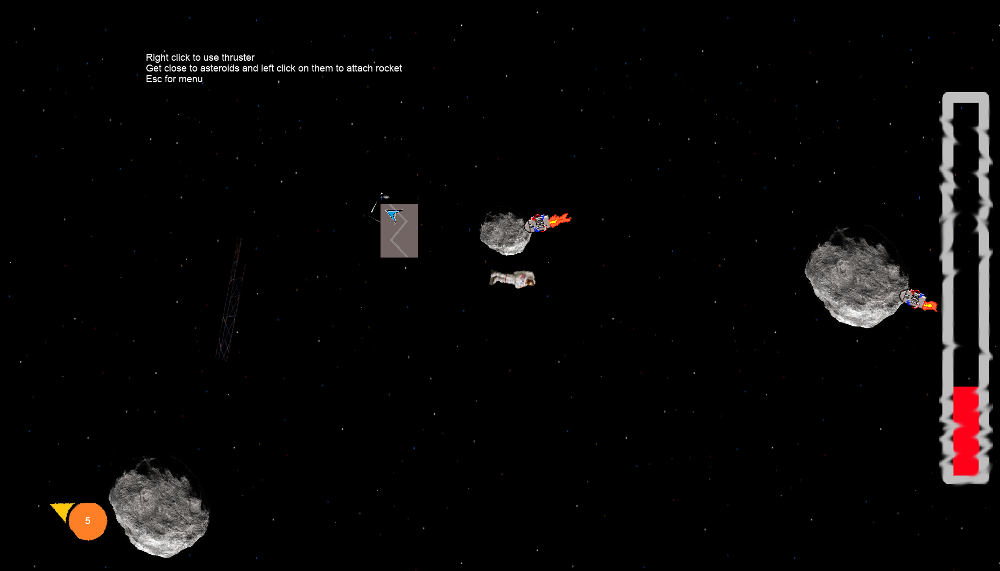

# Unnamed Space Game — 2D Engine

A custom 2D game engine and physics sandbox built from scratch in **C++** using Allegro and Box2D. Built in 2012 as a personal project during college, this was an early exploration of engine architecture and game systems design — no existing engine was used.

The design intent was a resource-collection survival game set in space: your ship has been damaged by an asteroid field, stranding you in zero gravity. Gather materials floating in the void, manage oxygen and fuel, and eventually rebuild your ship to escape the system. This build implements the engine foundation and physics sandbox; the gameplay loop was designed but never fully realized.



---

## What's implemented

**Custom game loop** — fixed 60Hz timer-driven update/render cycle built on Allegro's event queue, with separated update and render passes and render gating to avoid redundant draw calls.

**State machine** — `GameState` base class with `CreateGameState` factory and `ChangeState` transitions. Current states: main menu and resource collection. Esc toggles between them.

**GameObject hierarchy** — `GameObject → RenderObject → Player / SpaceCollectible / Astronaut / CollectorRocket` inheritance chain. All game objects share a common update/render interface.

**Physics integration** — Box2D world with zero gravity (space). `SimpleBox2D` wraps body creation and fixture setup. `AllegroBox2DDebugDraw` renders physics shapes directly for debugging (toggle with D key).

**Camera system** — world-space camera that tracks the player, with parallax scrolling background at a configurable scroll factor.

**Resource manager** — `ResourcesManager` handles bitmap and animation asset loading, retrieval by ID, and cleanup. All assets loaded at startup from a resource list.

**Animation system** — frame-based sprite animation with configurable frame rate, supporting sprite sheet slicing.

**Player + astronaut** — right-click thruster that applies Box2D impulses. The astronaut drifts with physics when not thrusting.

**Collector rocket** — left-click to attach a rocket to a nearby asteroid. Once attached, the rocket fires and pushes the asteroid with Box2D forces.

**Collectibles** — asteroids and columns spawn as Box2D dynamic bodies and float in space. Physics interactions (collisions, impulses) are handled by the engine.

**HUD** — fuel bar indicator on the right edge of the screen, compass indicator bottom-left pointing toward the origin (intended to mark the shipwreck; currently a floating door). Both implemented as `Indicator` subclasses.

**Camera zoom** — mouse wheel zooms the world in and out (0.35x–2.5x) around the screen centre with easing. Zoom is an Allegro transform on the world layer only; the starfield and HUD stay unscaled, and the mouse is converted back into world space for picking.

**Ship building** — LUMA-7 assembles rudimentary ships from square modules (hull and thruster) on a 1.2 m grid:
- Modules are spawned at the cursor for now (in the final game they are harvested from debris).
- Left-drag pulls a module or a whole ship with a tractor beam (a Box2D mouse joint limited to 7 m from the player). Q/E turn a held module in quarter turns.
- Releasing a module next to another shows a snap preview and attaches it. Every module of a ship is a fixture of one rigid body, so mass, centre of mass and inertia come from the layout.
- F clamps LUMA-7 onto the nearest ship. W/S fire the thrusters that push forward/backward, A/D the ones whose torque turns the ship that way, each applying force at its own nozzle, so the ship flies purely on physics.
- Each thruster is wired to any mix of six controls: W/S (forward/backward), A/D (turn left/right) and Q/E (strafe left/right). Each thruster applies force at its own nozzle, so the ship flies purely on physics. A new thruster is wired from its placement: forward-facing ones on W, ones with turning torque on A/D, sideways ones in line with the centre of mass on Q/E.
- Aboard, R opens the wiring. Hover a thruster and tap a control key to connect or disconnect it; it test-fires when connected. C disconnects it. Holding a key lights every thruster on that control without pushing the ship. A rewired thruster keeps its manual wiring, the rest keep following the layout.

**UI system** — `Menu`, `Button`, and `TextButton` components. Mouse input tracked via `MouseObject` and `MouseState`.

---

## Architecture

```
main.cpp
  ├── Allegro init (display, input, addons)
  ├── Box2D world setup (zero gravity)
  ├── Game::Init() + Game::StartGame()
  └── Event loop (input → update → render)

Game
  ├── ResourcesManager   — asset loading and retrieval
  ├── Camera             — world transform and parallax
  ├── MouseObject        — mouse state tracking
  ├── Player             — input, physics, thruster
  ├── ShipBuilder        — module spawning, tractor beam, snapping, piloting
  ├── MainMenu           — UI state
  └── GameState machine  — MAIN_MENU / RESOURCE_COLLECTION

GameObject (base)
  └── RenderObject
        ├── Astronaut
        ├── CollectorRocket
        ├── ShipModule      — hull / thruster block, loose or part of a ship
        ├── Ship            — rigid compound body built from modules
        └── SpaceCollectible
              ├── SpaceCollectible_Asteroid
              └── SpaceCollectible_Column
```

---

## What was designed but not implemented

- Oxygen management (timed depletion, replenishment from resources)
- Resource accounting and inventory
- Harvesting ship modules from debris (they are spawned with 1/2 for now)
- Escape condition / win state

---

## Controls

| Input | Action |
|-------|--------|
| Right click | Thruster |
| Left click | Attach rocket to nearby asteroid |
| Mouse wheel | Zoom in / out |
| 1 / 2 | Spawn a hull / thruster module at the cursor |
| Left drag | Move a module or ship with the tractor beam (release next to a module to attach) |
| Q / E | Rotate the held module a quarter turn; aboard, fire strafing thrusters |
| F | Board / leave the nearest ship |
| W / S | Fire forward / backward thrusters while aboard |
| A / D | Fire turning thrusters while aboard |
| R | Aboard: open / close the thruster wiring (hover a thruster, tap W/A/S/D/Q/E to toggle, C to clear) |
| Esc | Toggle menu |
| F3 | Toggle Box2D debug draw |

---

## Building

The build is defined in `CMakeLists.txt` (CMake 3.16+) and generates either a Visual Studio solution or a Linux/WSL build.

**Windows (Visual Studio 2022)** — dependencies come from the NuGet packages listed in `UnnamedCPPRemake/packages.config`; CMake restores them into `packages/` if they are missing.

```
cmake -S . -B build/msvc -G "Visual Studio 17 2022" -A x64
cmake --build build/msvc --config Debug
```

Open `build/msvc/UnnamedSpaceGame.sln` to debug, or open the repo folder directly in Visual Studio (it picks up CMake on its own).

**Linux / WSL** — needs Allegro 5 and Box2D 2.3 from the system packages. If `libbox2d-dev` is not installed but `packages/` has been restored, Box2D is built from the NuGet package's sources.

```
sudo apt install build-essential cmake pkg-config liballegro5-dev liballegro-image5-dev \
    liballegro-ttf5-dev liballegro-dialog5-dev libbox2d-dev
cmake -S . -B build/linux
cmake --build build/linux -j
./build/linux/UnnamedSpaceGame
```

Under WSL the window appears through WSLg. On both platforms the `resources/` folder is copied next to the executable after each build.

---

## Tech stack

- **C++** — no engine, built from scratch
- **Allegro 5** — windowing, rendering, input, audio addons
- **Box2D** — 2D rigid body physics

---

*Built in 2012 as a personal project during college. Recently documented.*